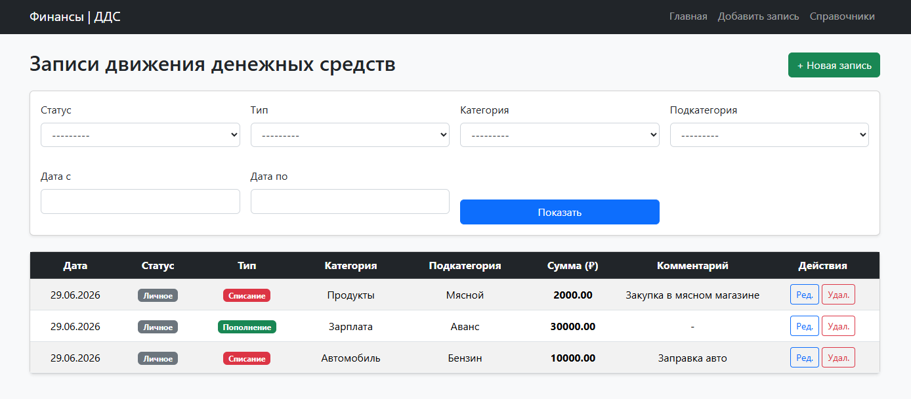
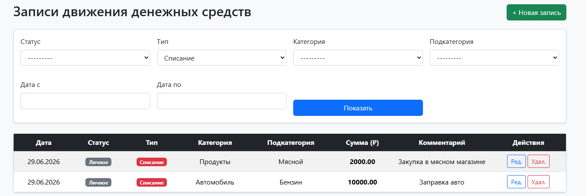
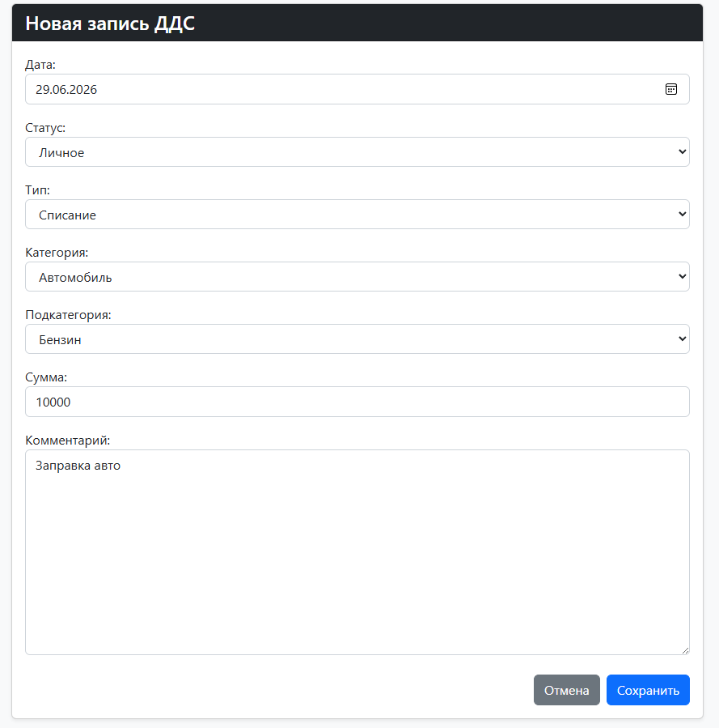
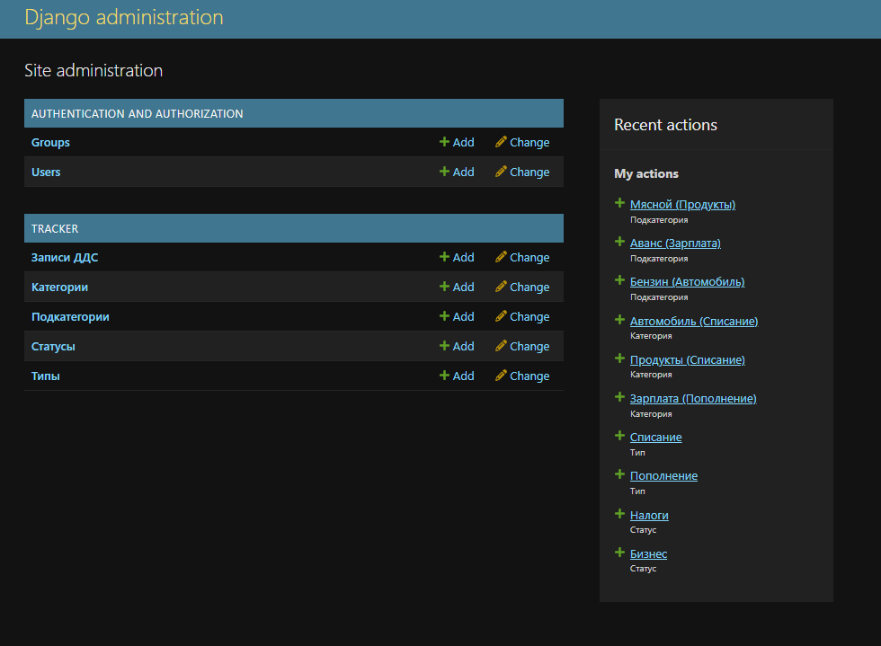

# Cash Flow Tracker

Веб-приложение для учёта движения денежных средств: финансовые операции,
связанные справочники, фильтрация и динамические формы.

## Возможности

- Создание, просмотр, редактирование и удаление операций.
- Справочники статусов, типов, категорий и подкатегорий.
- Проверка соответствия категории типу и подкатегории категории в форме.
- Фильтрация по датам и справочникам, пагинация списка.
- JSON-эндпоинты для динамического выбора категорий.

## Стек и архитектура

Python · Django · Django REST Framework · django-filter · SQLite  
Django ORM · Django Templates · JavaScript Fetch API · Bootstrap 5

Django-монолит: модели и формы находятся в `tracker/`, HTML-представления
обслуживают CRUD, а DRF — вспомогательные эндпоинты справочников.
Это не асинхронный микросервис.

Настройки и исходная миграция созданы на Django 6.0.6.
`requirements.txt` фиксирует эту версию Django и задаёт диапазоны двух
прямых зависимостей. Это восстановленный список зависимостей, не lock-файл;
совместимость чистой установки ещё нужно проверить.

## Локальный запуск

Используйте Python 3.12 или новее.

```bash
git clone https://github.com/watademt/DDS.git
cd DDS
python -m venv .venv
```

Windows PowerShell:

```powershell
.\.venv\Scripts\python.exe -m pip install -r requirements.txt
.\.venv\Scripts\python.exe manage.py migrate
.\.venv\Scripts\python.exe manage.py createsuperuser
.\.venv\Scripts\python.exe manage.py runserver
```

Linux / macOS:

```bash
.venv/bin/python -m pip install -r requirements.txt
.venv/bin/python manage.py migrate
.venv/bin/python manage.py createsuperuser
.venv/bin/python manage.py runserver
```

Откройте http://127.0.0.1:8000/admin/ и заполните справочники:
статусы, типы, категории и подкатегории. Затем откройте
http://127.0.0.1:8000/ и создайте операцию.

Локальная SQLite-база создаётся миграциями и не должна храниться в Git.
Используйте демонстрационные данные.

## Проверка

После установки зависимостей, используя Python из виртуального окружения:

```bash
python manage.py check
python manage.py makemigrations --check --dry-run
python manage.py test
```

Автоматические тесты поведения пока не реализованы. Успешный запуск
`manage.py test` без тестов не подтверждает корректность приложения.
Docker, CI и конфигурация линтеров пока не добавлены.

## Интерфейс



<details>
<summary>Фильтры, форма и администрирование</summary>





</details>

## Ограничения

Текущая конфигурация предназначена для локальной разработки:
`DEBUG=True`, разработческий ключ в настройках, без настроенного
разграничения доступа к CRUD-представлениям. Не размещайте её в интернете
с реальными финансовыми данными. Перед развёртыванием нужны отдельные
настройки окружения, новый секретный ключ, контроль доступа и тесты.

Удаление базы из текущей версии не удаляет её из истории Git.

## Автор

[watademt](https://github.com/watademt) · [Telegram](https://t.me/wat_ademt)
